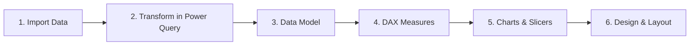

# Telecom Services Dashboard (Power BI)

**An interactive Power BI dashboard I built during the Advanced Power BI course on Hash Plus — analyzing a telecom company's revenue, billing and collection, customers, and customer support.**

---

## Table of Contents
- [About the Course](#about-the-course)
- [What the Project Contains](#what-the-project-contains)
- [How I Built It](#how-i-built-it)
- [Key Metrics](#key-metrics)
- [Insights](#insights)
- [Dashboard](#dashboard)
- [Skills Demonstrated](#skills-demonstrated)
- [Author](#author)

---

## About the Course

This project is one of the dashboards I built for the **Advanced Power BI** course offered by [Hash Plus](https://hashplus.com), an Arabic online learning platform. It is the next step in my data analysis learning path, after my earlier Power BI projects — [Hospital Patients Dashboard](https://github.com/wajd-cs/hospital-dashboard-powerbi) and [Car Rental Dashboard](https://github.com/wajd-cs/car-rental-dashboard-powerbi) — moving from a single flat table to a multi-table data model with DAX measures.

During the course, I built this dashboard to apply what I learned about data modeling, Power Query, and DAX.

## What the Project Contains

A Power BI report built on a telecom company's data (data in Arabic), made of five related tables:

| Table | Rows | Description |
|---|---|---|
| Customers | 20 | Name, gender, age, city, subscription date, customer type (individual or business), and subscription status |
| Usage & Billing | 20 | Branch, data usage (GB), call minutes, SMS, invoice amount, and invoice status |
| Plans | 20 | Plan name, service type (mobile, home internet, business, data, prepaid), and monthly fee |
| Complaints | 20 | Complaint type, contact channel, resolution time (hours), status, and satisfaction level |
| Branches | 10 | Branch name, city, region, manager, and staff numbers |

The dashboard includes:

- **5 KPI cards + 1 multi-row card** — total revenue, uncollected amounts, active customers, number of complaints, and satisfaction rate, plus a billing card for collection rate, churn rate, and overdue and unpaid invoices
- **6 charts** — revenue by branch (column chart), revenue by service type (donut chart), average bill vs. average plan fee (bar chart), customers by city (column chart), support requests by contact channel (donut chart), and resolution time over time (line chart)
- **1 table** — top customers by billing
- **2 slicers** — filter the whole report by city or customer type

## How I Built It

**1. Imported the data** from an Excel workbook into Power BI, using a **parameter for the file path** so the report can be pointed to a new file easily.

**2. Transformed it in Power Query**:
- Set the correct data type for every column
- Trimmed extra spaces from customer names and cities
- Removed duplicated columns (such as city and subscription status) from the billing and complaints tables, since they already live in the customers table
- Replaced `-` with "Not included" in plan details, and with `0` in usage data for plans without calls or SMS
- Added an **Age Group** column and a **Subscription Year** column to the customers table

**3. Built the data model** — the Usage & Billing and Complaints tables connected to Customers, Plans, and Branches.

**4. Wrote DAX measures** for every KPI:

| KPI | DAX |
|---|---|
| Total revenue | `SUM('Usage & Billing'[Invoice Amount])` |
| Collected revenue | `CALCULATE([Total revenue], 'Usage & Billing'[Invoice Status] = "Paid")` |
| Uncollected amounts | `[Total revenue] - [Collected revenue]` |
| Collection rate | `DIVIDE([Collected revenue], [Total revenue])` |
| Active customers | `CALCULATE(COUNTROWS('Customers'), 'Customers'[Subscription Status] = "Active") + 0` |
| Churn rate | `DIVIDE([Cancelled customers], [Number of customers])` |
| Satisfaction rate | `DIVIDE(CALCULATE(COUNTROWS('Complaints'), 'Complaints'[Satisfaction Level] IN {"Satisfied", "Very Satisfied"}), [Number of complaints])` |

**5. Created charts** that answer the main business questions:

| Chart | Type | Question |
|---|---|---|
| Revenue by branch | Column | Which branches bring in the most revenue? |
| Revenue by service type | Donut | Which services drive the business? |
| Average bill vs. plan fee | Bar | Do customers pay more than their plan fee? |
| Customers by city | Column | Where are the customers? |
| Top customers by billing | Table | Who are the highest-paying customers? |
| Support requests by channel | Donut | How do customers contact support? |
| Resolution speed | Line | How fast are requests handled over time? |

**6. Designed the layout** — KPI cards on top, revenue and customer charts in the middle, and support charts below, with an indigo theme.

## Key Metrics

| Metric | Value |
|---|---|
| Total revenue | 5,820 SAR |
| Collected revenue | 5,380 SAR |
| Uncollected amounts | 440 SAR |
| Collection rate | 92.4% |
| Active customers | 17 of 20 |
| Churn rate | 15% |
| Complaints | 20 |
| Satisfaction rate | 65% |
| Average resolution time | ~7 hours |

## Insights

- **Business plans drive the revenue** — they make up two-thirds of total revenue (3,850 SAR, 66%) from only 5 business invoices.
- **Al-Faisaliah branch brings in the most revenue** (1,660 SAR), followed by Al-Tahlia (1,430 SAR).
- **The app is the best support channel** — requests through the app were solved in about 2 hours on average and every customer was satisfied, while call-center requests took about 13 hours and only 1 in 7 customers was satisfied.
- **Collection is healthy but not complete** — 92.4% of billed revenue was collected, with 2 overdue invoices and 1 unpaid invoice.

*Note: with only 20 records per table, this project focuses on demonstrating Power BI techniques and dashboard design rather than statistically significant findings.*

## Dashboard

## Skills Demonstrated

- **Power Query** — parameters, trimming text, removing duplicate columns, replacing values, and adding custom columns
- **Data Modeling** — building relationships between two fact tables and three dimension tables
- **DAX** — writing measures with `CALCULATE`, `DIVIDE`, and `IN`, and reusing measures inside other measures
- **Data Visualization** — choosing chart types that match each business question
- **Interactive Filtering** — slicers that filter the entire report through a shared data model
- **Dashboard Design** — organizing revenue, customer, and support KPIs into one clear, consistent layout
- **Business Thinking** — linking billing and support data to show where revenue and customer satisfaction come from

## Author

**Wajd Alluhaibi**
Computer Science Student | Data Analysis & Software Development

